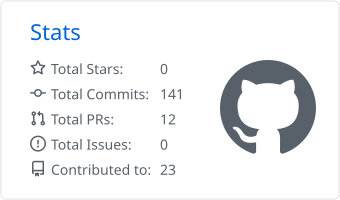
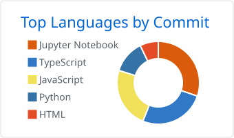

   
    
  
  
  

## About

- Final-year Computer Engineering student at **Vidyalankar Institute of Technology, Mumbai**.
- Full-stack developer (MERN) who adds AI/ML layers — LLM APIs, NLP pipelines, ML models — to real products.
- Interned as a Full Stack Web Developer at **MokBuzz Solutions** and as a MERN Intern at **UptoSkills**.
- Open to **full-time SDE / full-stack roles in 2027**.

**⚡ Quick facts:** 📍 Mumbai · 🎓 CE @ VIT '27 · 💼 2 internships · 🏆 Hackathons · 🎯 Open to SDE roles 2027

## 🔭 Currently building

**OfferShield** — a trust & verification desk for campus placement cells — and **MeetTrace**, an AI meeting-intelligence platform that verifies extracted decisions against the transcript (team project).

## 🚀 Featured Projects

<table>
  <tr>
    <td width="50%" valign="top">
      <h3>🛡️ <a href="https://github.com/SamarthBurkul/offershield-campus-trust-desk">OfferShield</a></h3>
      Turns students' "is this offer real?" questions into tracked placement-cell cases; confirmed findings power a "check before you pay" lookup. 
      <b>USP:</b> allegation-vs-finding governance — only a TPO-head decision creates a finding, and reopening a case revokes it. 
      <code>React</code> <code>Node.js</code> <code>Express</code> <code>MongoDB</code> <code>Tailwind</code> 
      <a href="https://offershield-l2rk.onrender.com">🔗 Live</a> · <a href="https://github.com/SamarthBurkul/offershield-campus-trust-desk">📂 Repo</a>
    </td>
    <td width="50%" valign="top">
      <h3>🎙️ <a href="https://github.com/SamarthBurkul/MeetTrace">MeetTrace</a></h3>
      Meeting audio → transcript, speakers, topics, decisions and action items, verified against transcript evidence. 
      <b>USP:</b> an NLI-based evidence verifier checks extracted claims against transcript spans before they are reported. 
      <code>Python</code> <code>FastAPI</code> <code>faster-whisper</code> <code>pyannote</code> <code>React</code> 
      <a href="https://github.com/SamarthBurkul/MeetTrace">📂 Repo</a>
    </td>
  </tr>
  <tr>
    <td width="50%" valign="top">
      <h3>💰 <a href="https://github.com/SamarthBurkul/finsaarthi-ai">FinSaarthi AI</a></h3>
      AI finance companion for India — wallet simulator, fraud risk scoring and an LLM finance assistant. 
      <b>USP:</b> rule-based fraud engine scores each transaction 0–100 across 7 detection rules. 
      <code>React</code> <code>TypeScript</code> <code>Express</code> <code>MongoDB</code> <code>Groq (Llama 3.1)</code> 
      <a href="https://finsaarthiai.vercel.app">🔗 Live</a> · <a href="https://github.com/SamarthBurkul/finsaarthi-ai">📂 Repo</a>
    </td>
    <td width="50%" valign="top">
      <h3>🌍 <a href="https://github.com/SamarthBurkul/AirWatch-">AirWatch</a></h3>
      Localized AQI monitoring dashboard with short-term AQI prediction, map view and health tips. 
      <b>USP:</b> RandomForest model predicts AQI from 12 pollutant features, with feature-importance explainability. 
      <code>Python</code> <code>Flask</code> <code>scikit-learn</code> <code>PostgreSQL</code> <code>Docker</code> 
      <a href="https://airwatch-0j5i.onrender.com">🔗 Live</a> · <a href="https://github.com/SamarthBurkul/AirWatch-">📂 Repo</a>
    </td>
  </tr>
  <tr>
    <td width="50%" valign="top">
      <h3>📚 <a href="https://github.com/SamarthBurkul/knowledge-base-helpdesk">Knowledge Base Helpdesk</a></h3>
      Centralized, searchable knowledge base with role-based access for users, support staff and admins. 
      <b>USP:</b> Jenkins pipeline runs tests, Docker build, Selenium UI tests and a health-gated deploy; Ansible rollback verified. 
      <code>Java</code> <code>Spring Boot</code> <code>Thymeleaf</code> <code>Docker</code> <code>Jenkins</code> <code>Ansible</code> 
      <a href="https://github.com/SamarthBurkul/knowledge-base-helpdesk">📂 Repo</a>
    </td>
    <td width="50%" valign="top">
      <h3>🔍 <a href="https://github.com/SamarthBurkul/Aura-Crime-Intel">CivicSentinel (Aura Crime Intel)</a></h3>
      Crime analytics and prediction for 29 Indian cities — early-warning alerts, intervention simulator and crime heatmap. 
      <b>USP:</b> Random Forest model trained on merged NCRB (2014–2021) and incident-level (2020–2024) data. 
      <code>Python</code> <code>Flask</code> <code>scikit-learn</code> <code>React</code> <code>Tailwind</code> 
      <a href="https://github.com/SamarthBurkul/Aura-Crime-Intel">📂 Repo</a>
    </td>
  </tr>
</table>

## 🛠 Tech Stack

  <b>Frontend</b>   
  <b>Backend &amp; DB</b>   
  <b>AI/ML &amp; DevOps</b> 

<b>💼 Experience</b>

 

- **Full Stack Web Developer Intern — MokBuzz Solutions** (Apr–Jun 2026): worked on BIGISO, an ISO-management SaaS, with React, Node.js and MySQL.
- **MERN Intern — UptoSkills**: contributed to a live ed-tech platform built on the MERN stack.

<b>📁 More 2026 projects</b>

 

- [Forgery Vision (ForensicAI)](https://github.com/SamarthBurkul/forgery-vision) — image tampering detection fusing ELA (DenseNet121), SIFT copy-move and Grad-CAM; Flask + React.
- [NexusLife](https://github.com/SamarthBurkul/NexusLife) — consent-based digital identity passport with an AI life advisor; hackathon build ([live](https://nexus-life-pink.vercel.app)).
- [SentinelMesh](https://github.com/SamarthBurkul/SentinelMesh) — AI cybersecurity mesh: phishing/deepfake detection, malware analysis, honeypot and policy RAG; hackathon build.
- [AuditCV](https://github.com/SamarthBurkul/AuditCV-) — explainable ATS that matches resumes with Sentence-BERT and verifies claims against GitHub evidence.
- [Job Market Data Platform](https://github.com/SamarthBurkul/job-market-data-platform) — ETL from raw job listings into a star-schema warehouse and analytical data marts with DuckDB.

## 📊 GitHub Activity

<table align="center">
  <tr>
    <td>
      <picture>
        <source media="(prefers-color-scheme: dark)" srcset="https://raw.githubusercontent.com/SamarthBurkul/SamarthBurkul/main/profile-summary-card-output/github_dark/3-stats.svg" />
        
      </picture>
    </td>
    <td>
      <picture>
        <source media="(prefers-color-scheme: dark)" srcset="https://raw.githubusercontent.com/SamarthBurkul/SamarthBurkul/main/profile-summary-card-output/github_dark/2-most-commit-language.svg" />
        
      </picture>
    </td>
  </tr>
</table>

  <picture>
    <source media="(prefers-color-scheme: dark)" srcset="https://raw.githubusercontent.com/SamarthBurkul/SamarthBurkul/output/github-snake-dark.svg" />
    <source media="(prefers-color-scheme: light)" srcset="https://raw.githubusercontent.com/SamarthBurkul/SamarthBurkul/output/github-snake.svg" />
    
  </picture>

  Let's build something — <a href="LINKEDIN_URL">LinkedIn</a> · <a href="mailto:EMAIL">Email</a> · <a href="PORTFOLIO_URL">Portfolio</a>  
  

